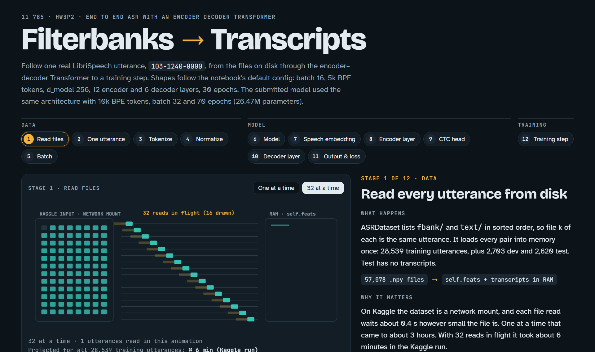
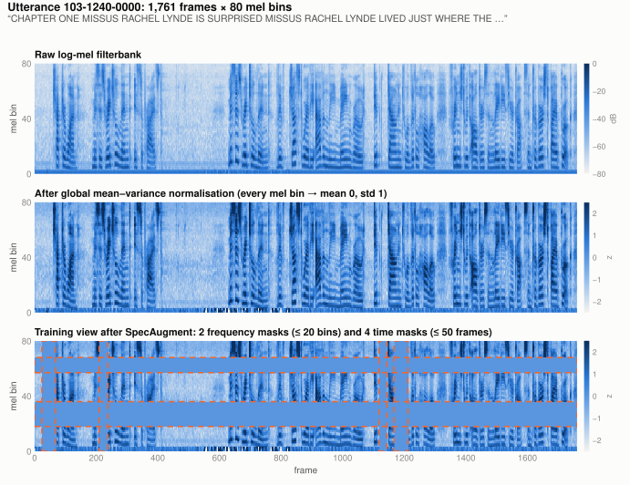
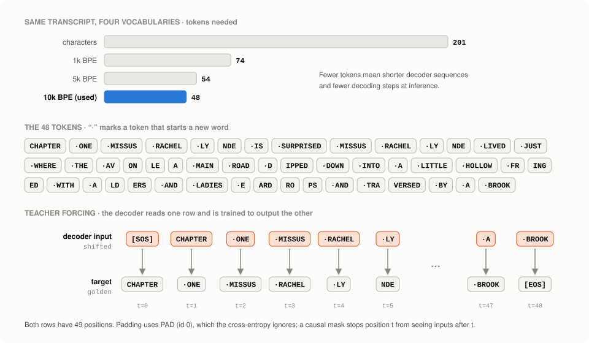
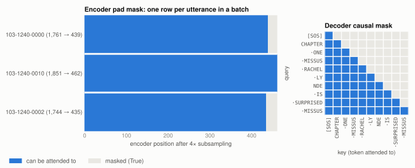
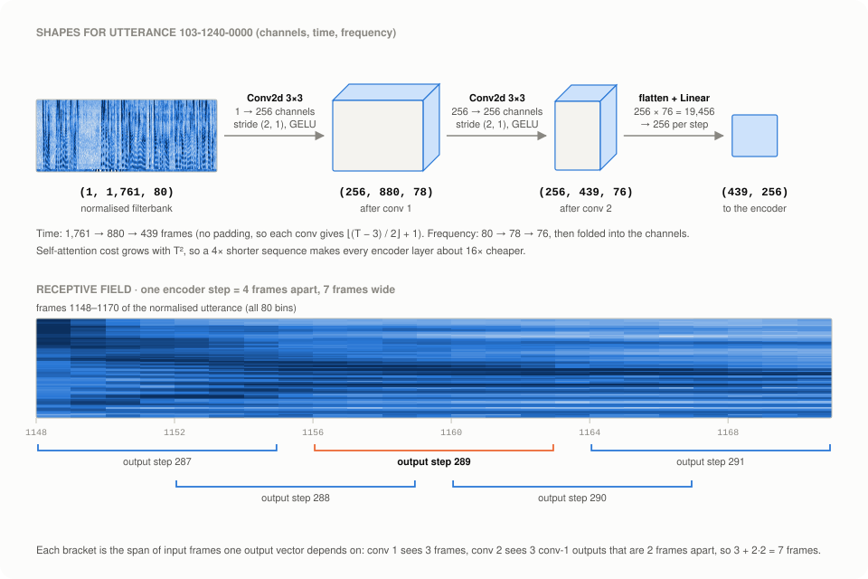
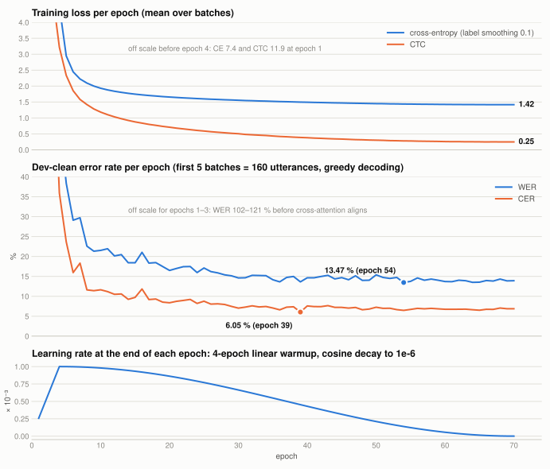
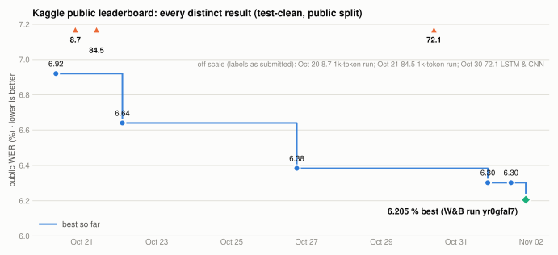

# End-to-End Speech Recognition with an Encoder–Decoder Transformer

**CMU 11-785 Introduction to Deep Learning · Fall 2026 · Homework 3, Part 2 (Kaggle)**

An encoder–decoder Transformer, built from basic PyTorch layers, that turns 80-bin log-mel
filterbank features of read English speech into text. A convolutional front end shortens the
audio four times. A 12-layer encoder then reads it, and a 6-layer decoder writes the transcript
as 10k-vocabulary BPE tokens. Training uses cross-entropy plus an auxiliary CTC loss. The final
model has 26.47 M parameters and reaches a **5.075 % word error rate on the Kaggle private
leaderboard** (6.205 % public). On the `dev-clean` validation set it scores 10.31 % with beam
search and 11.05 % greedy.

<p align="left">
  
  
  
  
  
</p>

> **Interactive walkthrough.** [`docs/explainer.html`](docs/explainer.html) follows one real
> utterance through the whole pipeline in 12 animated stages: files, spectrogram, tokens,
> normalisation, batching, model overview, speech embedding, encoder layer, CTC head, decoder
> layer, output and loss, and one training step. Download it and open it in a browser.
>
> <a href="docs/explainer.html"></a>

---

## Contents

1. [Problem](#problem)
2. [Dataset](#dataset)
3. [Approach](#approach)
4. [Architecture](#architecture)
5. [Training](#training)
6. [Results and experiment history](#results-and-experiment-history)
7. [Repository structure](#repository-structure)
8. [Reproducing the results](#reproducing-the-results)
9. [Acknowledgements](#acknowledgements)

---

## Problem

Automatic speech recognition (ASR) maps a recording to the words that were spoken. This project
treats it as **sequence-to-sequence** learning. The input is a long sequence of acoustic frames,
often more than a thousand per sentence. The output is a much shorter sequence of text tokens.
Nothing tells the model which frames belong to which word. It has to learn that alignment itself.
An encoder summarises the audio, and an autoregressive decoder writes the transcript one token at
a time while *attending* to the relevant part of the audio.

| Constraint | Value |
|---|---|
| Model | Encoder–decoder Transformer, every component implemented in the `hw3lib` library |
| Parameter budget | **< 30 M** trainable parameters |
| Pre-trained weights | Not allowed (built from `Linear`, `Conv2d`, `Embedding`, …) |
| External data | Not allowed |
| Metric | Word error rate on `test-clean`, scored by Kaggle (public / private split) |

WER counts the word substitutions *S*, deletions *D* and insertions *I* needed to turn the
prediction into the reference: WER = (*S* + *D* + *I*) / *N*, where *N* is the number of reference
words. Lower is better.

## Dataset

The data is LibriSpeech read English speech, supplied by the course as one NumPy file per
utterance. Each utterance has an `fbank/*.npy` filterbank matrix of shape `(80, T)`. The two
training splits also have a `text/*.npy` transcript, stored as an array of characters (upper-case
letters, space and apostrophe).

| Split | Utterances | Longest (frames) | Transcript | Role |
|---|---:|---:|---|---|
| `train-clean-100` | 28,539 | 3,066 | ✔ | training; source of the normalisation statistics |
| `dev-clean` | 2,703 | 4,081 | ✔ | validation, checkpoint and beam-width selection |
| `test-clean` | 2,620 | 4,370 | — | Kaggle predictions |

With the 10k tokenizer, a training transcript averages **4.64 characters per token**. The longest
needs 89 decoder positions, counting the `[SOS]`/`[EOS]` token (122 in `dev-clean`). A small subset of each split ships in
[`hw3_data_subset/`](hw3_data_subset) for local tests. All figures below use its utterance
`103-1240-0000`.

### From audio to filterbanks

A microphone records a *waveform*: air pressure sampled thousands of times per second. Raw samples
are hard to learn from, so speech systems convert them into a time–frequency picture first. The
competition provides these features pre-computed. The standard recipe behind them is:

1. **Framing.** The waveform is cut into short overlapping windows. Within one window the sound is
   roughly steady.
2. **Fourier transform.** An FFT of each window gives its spectrum: how much energy is present at
   each frequency.
3. **Mel filterbank.** The spectrum is pooled into **80 overlapping bands** spaced on the mel
   scale. The bands are narrow at low frequencies, where most speech information lies, and wider
   at high frequencies, roughly as human hearing works.
4. **Log compression.** Energies are expressed in decibels. In this dataset they are clipped to
   [−80, 0] dB.

The result is a matrix with one column per frame and one row per mel band. The handout does not
state the window and hop lengths. The patterns in this matrix are what the model learns from:

- **Vowels** show stacked horizontal stripes (*harmonics*) and broader bright bands (*formants*).
  Where the formants sit tells one vowel from another.
- **Fricatives** such as *s* and *sh* put their energy in the upper bands.
- **Stops** such as *p*, *t* and *k* show a short gap, then a broadband burst.
- **Silence and pauses** are low everywhere.

### What the model sees

<picture>
  <source media="(prefers-color-scheme: dark)" srcset="assets/features-dark.svg">
  
</picture>

Time runs left to right and frequency runs bottom to top. Colour encodes energy: darker in the
light theme, brighter in the dark theme. All three panels come from the project's own
`ASRDataset` code:

- **Raw log-mel.** The voiced stretches show the striped harmonic and formant structure described
  above, and the pauses show up as quiet vertical gaps.
- **Global MVN.** Every mel bin is standardised with the training set's per-bin mean and standard
  deviation, so loud low-frequency bins no longer dominate. In this figure the statistics come
  from the 28-utterance handout subset. The real run uses all 28,539 training utterances.
- **SpecAugment.** `collate_fn` sets random frequency bands and time spans to 0, the mean after
  normalisation (orange outlines). Here the masks cover bins 18–35 and 57–67 and four time spans
  between frames 24 and 1,211. The model has to recognise words from partial evidence. This
  happens to training batches only.

## Approach

The model reads the whole utterance at once (it is not streaming) and is trained with **teacher
forcing**. At every position, the decoder receives the true previous tokens and learns to predict
the next one. The pipeline, step by step:

1. **Load and cache every utterance in RAM, in parallel.** The Kaggle dataset is a network mount
   where every small-file read waits on latency. Reading the 57,078 training files one at a time
   took about 3 hours. With 32 reads in flight (`data.load_threads: 32`) the training split loads
   in under 2 minutes (1 min 50 s in the final Kaggle session), and the result is byte-identical.
   Features are kept in float16 to halve RAM use.
2. **Normalise with global statistics.** Per-bin mean and variance are computed once over the
   training split, using Welford's streaming algorithm. They are then applied to all three
   splits, so `dev` and `test` never influence them.
3. **Tokenise the transcripts** with a byte-level **10k BPE** vocabulary (PAD 0, SOS 3, EOS 4).
   Each transcript is stored twice: *shifted* (`[SOS] + y`, the decoder input) and *golden*
   (`y + [EOS]`, the target).
4. **Batch and augment.** `collate_fn` pads utterances and transcripts to the longest in the batch
   and keeps their true lengths, which later become attention masks. During training it then
   applies **SpecAugment**: 2 frequency masks of up to 20 bins and 4 time masks of up to 50 frames.
5. **Shorten the audio 4×** with a two-layer Conv2D front end (1,761 → 880 → 439 frames for the
   example). Attention cost grows with the square of the length, so this makes every encoder
   layer about 16× cheaper.
6. **Encode** with 12 pre-norm Transformer layers. Their self-attention is bidirectional, and only
   padding is masked. A **CTC head** on the encoder output adds a second, alignment-based loss.
7. **Decode** with 6 pre-norm layers: causal self-attention over the tokens so far, then
   **cross-attention** into the encoder output, then a feed-forward network. A linear layer tied
   to the token embedding gives logits over the 10,000 tokens.
8. **Optimise CE + 0.3 × CTC** with AdamW, warmup and cosine decay, fp16 mixed precision and
   gradient clipping.
9. **Select on `dev-clean`, then predict.** The notebook decodes the whole dev set greedily with
   the *best* and *last* checkpoints and keeps the better one. It then compares beam widths 1 and
   5 and uses the winner, width 5, to transcribe `test-clean` for Kaggle.

### Tokens and teacher forcing

<picture>
  <source media="(prefers-color-scheme: dark)" srcset="assets/tokens-dark.svg">
  
</picture>

Frequent words stay whole (`CHAPTER`, `·SURPRISED`), and rare names split into pieces (`·LY` +
`NDE`, `·AV` + `ON` + `LE` + `A`). A larger vocabulary gives shorter targets: here 48 decoder
steps instead of 201 with characters. That makes training and beam search cheaper.

### Attention masks

<picture>
  <source media="(prefers-color-scheme: dark)" srcset="assets/masks-dark.svg">
  
</picture>

Two boolean masks, built by `hw3lib.model.masks`, keep attention honest:

- **Pad mask.** It stops any query from attending to padding. It applies in the encoder and in
  cross-attention.
- **Causal mask.** It stops decoder position *t* from looking at tokens after *t*. Without it,
  teacher forcing would let the model copy the answer.

## Architecture

<picture>
  <source media="(prefers-color-scheme: dark)" srcset="assets/architecture-dark.svg">
  
</picture>

Both stacks use `d_model = 256`, 4 attention heads of size 64, and **pre-norm** residual blocks.
Each sublayer reads a normalised copy of the stream and adds its output back:

```
encoder layer:  x ← x + SelfAttn(RMSNorm(x))       # bidirectional, pad mask, RoPE, QK-norm
                x ← x + SwiGLU(RMSNorm(x))          # 256 → 682 → 256

decoder layer:  x ← x + SelfAttn(RMSNorm(x))       # causal + pad mask, RoPE, QK-norm
                x ← x + CrossAttn(RMSNorm(x), mem)  # queries: text, keys/values: encoder
                x ← x + SwiGLU(RMSNorm(x))
```

### The convolutional front end

<picture>
  <source media="(prefers-color-scheme: dark)" srcset="assets/subsampling-dark.svg">
  
</picture>

The filterbank enters as a one-channel image. Two 3 × 3 convolutions, each followed by GELU,
stride 2 along time and 1 along frequency, with no padding. That shortens time 4× and trims the
frequency axis to 76 positions. The 256 channels × 76 positions at each time step are then
flattened and projected to the model width. As a result, every encoder position summarises a
7-frame window, and neighbouring positions are 4 frames apart. The true lengths go through the
same arithmetic, so the pad mask still lines up.

### Parameter count

| Component | Shape | Parameters |
|---|---|---:|
| Conv2D speech embedding | Conv 1→256 (2,560) · Conv 256→256 (590,080) · Linear 19,456→256 (4,980,992) | 5,573,632 |
| Encoder layers × 12 | per layer: self-attention 263,552 + SwiGLU 524,032 | 9,451,008 |
| Encoder final LayerNorm | 256 | 512 |
| CTC head | Linear 256 → 10,000 | 2,570,000 |
| Token embedding (shared with output weight) | 10,000 × 256 | 2,560,000 |
| Decoder layers × 6 | per layer: self-attention 263,552 + cross-attention 263,552 + SwiGLU 524,032 | 6,306,816 |
| Decoder final LayerNorm | 256 | 512 |
| Output projection bias (weight tied) | 10,000 | 10,000 |
| **Total** | | **26,472,480** |

Each attention block has 4 × (256 × 256 + 256) projection parameters, plus 64 + 64 for the
QK-norm scales and 256 for its pre-norm. Each SwiGLU has 3 × 256 × 682 weights plus 256 for its
pre-norm. The total matches `model.parameters()` and
[`submission_artifacts/model_metadata.json`](submission_artifacts/model_metadata.json).

### Design choices

- **Conv subsampling before attention.** A 1,761-frame utterance becomes 439 encoder positions.
  That keeps a 12-layer encoder affordable on a single GPU and leaves the frame-level detail to
  the convolutions.
- **Deep encoder, lighter decoder (12 / 6).** Most of the work is modelling the audio. The decoder
  behaves more like a conditional language model over short token sequences.
- **Pre-norm + RMSNorm.** Normalising each sublayer's input keeps the residual stream well scaled
  through 18 layers, and RMSNorm is cheaper than LayerNorm. The final encoder and decoder norms
  are LayerNorm, as in the starter design.
- **RoPE in self-attention.** Rotary embeddings rotate queries and keys, so attention scores depend
  on the relative distance between positions. Cross-attention uses no positional rotation,
  because text and audio positions are not on the same scale.
- **QK-norm.** RMS-normalising queries and keys per head bounds the attention logits. That helps
  under fp16 autocast.
- **SwiGLU with hidden size 682** (= ⅔ × 1,024). The gated unit has three matrices, so this keeps
  its parameter count equal to a 1,024-wide GELU network.
- **Auxiliary CTC loss (weight 0.3).** CTC makes the encoder alone produce a monotonic
  frame-to-token alignment. This is the standard hybrid CTC/attention recipe. The logged runs
  include no ablation of its weight.
- **Weight tying and a 10k vocabulary.** Sharing the embedding and output matrices saves 2.56 M
  parameters. The large vocabulary gives the shortest targets, and both together keep the model
  under the 30 M budget.

## Training

| Setting | Value |
|---|---|
| Loss | Cross-entropy (label smoothing 0.1, PAD ignored) + 0.3 × CTC (blank = PAD id 0) |
| Optimiser | AdamW, peak lr 1e-3, betas (0.9, 0.98), eps 1e-8, weight decay 0.01 |
| LR schedule | Linear warmup from 1 % of the peak over 4 epochs, then cosine decay to 1e-6 over 66 epochs; stepped after every optimiser update |
| Batch | 32 utterances × 2 gradient-accumulation steps = 64 per update (892 batches, 446 updates per epoch) |
| Epochs | 70 (31,220 optimiser updates) |
| Precision and stability | fp16 autocast + `GradScaler`; gradient clipping at global norm 1.0 |
| Regularisation | SpecAugment, dropout 0.1, weight decay, label smoothing |
| Hardware | One NVIDIA V100 32 GB on PSC Bridges-2; 6.8 h wall-clock, about 5.9 min per epoch including validation |
| Tracking | Weights & Biases run `yr0gfal7` (losses, dev WER/CER, learning rate, attention maps) |

Every epoch the trainer saves `checkpoint-last-epoch-model.pth`. When the dev CER improves it also
saves `checkpoint-best-metric-model.pth`. Both carry the optimiser, scheduler, scaler and W&B
state, so a run can resume in a new session (`training.resume_checkpoint`). The exact
configuration is [`configs/final.yaml`](configs/final.yaml).

## Results and experiment history

| Evaluation | WER |
|---|---:|
| **Kaggle private leaderboard** (`test-clean`, held-out split) | **5.075 %** |
| Kaggle public leaderboard (`test-clean`, public split) | 6.205 % |
| `dev-clean`, all 2,703 utterances, beam search (width 5) | 10.31 % |
| `dev-clean`, all 2,703 utterances, greedy | 11.05 % |

Beam search lowered the dev WER by 0.74 points (about 7 % relative), so the Kaggle predictions
use width 5. The two leaderboard numbers score the same predictions on different halves of
`test-clean`. The private split came out 1.13 points lower, so the public score was not inflated
by over-fitting it. Kaggle's scores come from the competition's own scorer, while the dev numbers
are corpus-level WER from `torchmetrics` in the notebook. The handout does not document the
competition's scoring, so the leaderboard and dev numbers are best read separately.

<picture>
  <source media="(prefers-color-scheme: dark)" srcset="assets/training-dark.svg">
  
</picture>

The curves come from the W&B export in
[`submission_artifacts/wandb_export.pkl`](submission_artifacts/wandb_export.pkl). The per-epoch
dev numbers are a quick monitor: greedy decoding of the first 5 batches (160 utterances). They
run higher and noisier than the full-dev evaluation above.

<picture>
  <source media="(prefers-color-scheme: dark)" srcset="assets/kaggle-dark.svg">
  
</picture>

| Date | Submission label (as typed) | Public WER |
|---|---|---:|
| Oct 20 | Baseline | 6.920 |
| Oct 20 | Baseline_1k_tokenizer_splitter | 8.720 |
| Oct 21 | Baseline_1k_tokenizer_splitter | 84.498 |
| Oct 22 | Baseline_40_epochs | 6.640 |
| Oct 26 | Baseline_40_epochs | 6.383 |
| Oct 30 | LSTM & CNN | 72.097 |
| Oct 31 / Nov 1 | Baseline_60_epochs / Baseline_40_epochs | 6.302 |
| **Nov 1** | **Baseline_60_epochs: the 70-epoch run `yr0gfal7` described here** | **6.205** |

The W&B export contains only the final run, so the earlier submissions are known by their labels
and scores alone. The full list, including later re-uploads of the final predictions with their
W&B tag, is in
[`submission_artifacts/kaggle_metadata.json`](submission_artifacts/kaggle_metadata.json). That
file was exported before the private leaderboard was released, so it holds public scores only. The
final private score, 5.075 %, comes from Kaggle's Submissions page.

**Observations**

- **Alignment arrives suddenly.** Monitor WER is above 100 % for epochs 1–3 (102 %, 110 %, 121 %).
  At that stage the free-running decoder emits more words than the references contain. WER then
  drops to 54.9 % at epoch 4, when warmup reaches the peak learning rate, and to 29.1 % at epoch
  6. That is the point at which cross-attention locks onto the audio.
- **Most of the gain comes in the first third.** Monitor WER is 18.4 % by epoch 14 and ends at
  13.9 %. During the long cosine tail it moves within roughly 13.5–15.5 %, while training CE keeps
  creeping down (1.50 at epoch 39 → 1.42 at epoch 70) and CTC loss falls from 0.39 to 0.25.
- **Training CE is close to its floor.** With label smoothing 0.1 over 10,000 classes, the lowest
  achievable cross-entropy is the entropy of the smoothed target, about **1.25 nats**. The final
  1.42 is close to that floor, even with dropout and SpecAugment active, so the plateau does not
  mean the model stopped learning.
- **Decoding matters.** At inference time, beam search (width 5) is worth 0.74 WER points on dev
  over greedy decoding.
- **Steady leaderboard progress.** The public WER improved from 6.92 to 6.205 over 12 days. The
  two submissions labelled as 1k-tokenizer runs and the one labelled "LSTM & CNN" (8.7, 84.5 and
  72.1) did not beat the baseline.

## Repository structure

```
.
├── README.md
├── HW3P2_Student_Starter_Notebook_F26.ipynb  # End-to-end notebook: setup, tests, training, selection, inference, submission
├── configs/
│   └── final.yaml                    # Exact configuration of the submitted model (W&B run yr0gfal7)
├── hw3lib/                           # The library built in this homework
│   ├── data/                         #   ASRDataset (parallel loading, MVN, SpecAugment), BPE tokenizers
│   ├── model/                        #   masks, RoPE / sinusoidal PE, RMSNorm, attention, sublayers,
│   │                                 #   encoder / decoder layers, speech embedding, EncoderDecoderTransformer
│   ├── decoding/                     #   greedy and beam-search SequenceGenerator
│   ├── trainers/                     #   ASRTrainer (CE + CTC, AMP, checkpoints, W&B), ProgressiveTrainer
│   └── utils/                        #   optimiser and LR-scheduler factories
├── tests/                            # Unit tests for every component (python -m tests.<name>)
├── hw3_data_subset/                  # 28 + 2 + 2 utterances for local tests and the README figures
├── assets/                           # README figures (light / dark SVG) + explainer preview
├── scripts/
│   └── make_figures.py               # Regenerates every figure from the subset, the config and the logs
├── docs/
│   ├── explainer.html                # Interactive 12-stage walkthrough of the pipeline
│   └── handout-README.md             # The original course handout README (setup notes)
├── submission_artifacts/             # Files generated for the course code submission
│   ├── README.txt                    #   short model summary
│   ├── ACKNOWLEDGEMENT.txt           #   academic-integrity acknowledgement
│   ├── model_metadata.json           #   architecture repr + parameter count
│   ├── kaggle_metadata.json          #   every Kaggle submission and score
│   └── wandb_export.pkl              #   W&B history of the final run
└── requirements.txt
```

The full dataset and the model checkpoints are not included.

## Reproducing the results

The notebook detects where it runs (**Kaggle**, **Colab**, **PSC Bridges-2** or **local**), and
the cells for other platforms skip themselves. Every hyper-parameter lives in YAML.

1. **Local environment and tests (CPU is enough):**

   ```bash
   conda create -n hw3 python=3.12.4
   conda activate hw3
   pip install -r requirements.txt
   for t in tests/test_*.py; do python -m tests.$(basename "$t" .py); done
   ```

   Run the tests from the repository root (`python -m tests.<name>`). Running the test files
   directly fails because `hw3lib` is then not importable.
2. **Data.** Join the course Kaggle competition, then attach the dataset
   `cmu11785/f26-hw3p2-data` as a notebook input on Kaggle. On Colab and PSC, the notebook
   downloads it through the Kaggle API.
3. **Credentials.** Provide them as secrets or environment variables, never as literals:

   ```bash
   export KAGGLE_USERNAME="<your-kaggle-username>"
   export KAGGLE_API_TOKEN="<your-kaggle-api-token>"   # starts with KGAT_
   export WANDB_API_KEY="<your-wandb-api-key>"
   export GITHUB_TOKEN="<token>"                       # only needed to clone a private fork
   ```

   On Kaggle, add the same names under *Add-ons → Secrets*. On Colab, use the key icon.
4. **Train.** In the config-loading cell, set `CONFIG_PATH = "configs/final.yaml"`, then run all
   cells. The final run took 6.8 h on a V100. On a 12-hour Kaggle T4 session,
   `training.time_budget_hours` stops cleanly before the limit. You can then continue in a new
   session with `training.resume_checkpoint` (a `.pth` path or `wandb:entity/project/run_id`) and
   `training.wandb_run_id`.
5. **Inference only.** Point `training.resume_checkpoint` at a finished checkpoint. Training is
   skipped because the epoch counter is already at the target. The notebook then selects the
   checkpoint and beam width on `dev-clean` and writes `results.csv` (`id,transcription`).
6. **Figures.** The script runs on CPU in about 10 seconds:

   ```bash
   python scripts/make_figures.py
   ```

## Acknowledgements

This work was completed for **11-785 Introduction to Deep Learning** at Carnegie Mellon
University. The course staff provided:

- the dataset and the BPE tokenizer files;
- the `hw3lib` skeleton and its unit tests;
- the trainer scaffolding, the starter notebook and the submission tooling.

This repository adds:

- the implementations of every `hw3lib` component (dataset, masks, positional encodings, RMSNorm,
  attention, sublayers, encoder and decoder layers, the Transformer, greedy and beam decoding,
  and the trainer's training and validation logic);
- parallel data loading;
- the YAML-driven, multi-platform notebook pipeline;
- the experiments and figures.

No pre-trained weights or external data were used, in line with the course's academic-integrity
policy. LibriSpeech is by Panayotov et al. (2015) and is released under CC BY 4.0.

**Author:** Martin Koome
